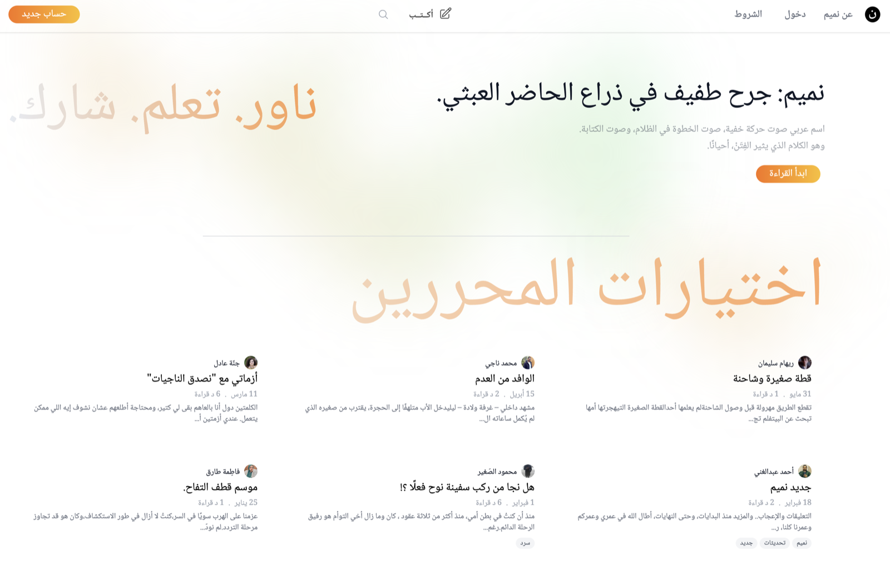

# Nameem — نميم

> A minor wound on the arm of the absurd present.



Nameem is an Arabic-first, right-to-left article publishing platform. Writers publish long-form articles; readers follow authors and topics, like, bookmark, and discuss them in threaded comments.

## Features

- Rich article editor built on [Lexical](https://lexical.dev) (images, video, embeds, dividers)
- Passwordless sign-in with emailed 6-digit codes
- Feeds: latest, trending, picked, and following
- Tags and topics, Arabic-aware search, related articles
- Follows, likes, bookmarks, threaded comments, notifications and email digests
- Per-article analytics for authors
- Admin backoffice for users, articles, comments and tags
- SEO metadata, structured data and sitemaps

## Tech stack

- Ruby 4.0 / Rails 8.2 (edge)
- MySQL 8.0
- Hotwire (Turbo + Stimulus), ImportMap, no JS bundler
- Tailwind CSS 4
- Solid Queue for background jobs
- Kamal for deployment

## Getting started

### Requirements

- Ruby (see `.ruby-version`); [mise](https://mise.jdx.dev) or rbenv work well
- MySQL 8.0
- A Procfile runner such as [Overmind](https://github.com/DarthSim/overmind) or Foreman

### Setup

```bash
git clone https://github.com/ahyield/nameem.git
cd nameem
cp .env.example .env.development   # then fill in your MySQL credentials
bundle install
bin/rails db:prepare
bin/rails db:seed                  # optional: fake users and articles
bin/dev
```

The app runs at http://localhost:3000.

In development, emails (including sign-in codes) are opened in your browser via [letter_opener](https://github.com/ryanb/letter_opener) instead of being sent.

### Credentials

Third-party keys (Resend, AWS S3, Turnstile, digitup) are read from Rails encrypted credentials. The encrypted files in this repo belong to the hosted Nameem instance and can't be decrypted without its keys. To run your own instance, delete them and create your own:

```bash
rm config/credentials.yml.enc config/credentials/*.yml.enc
bin/rails credentials:edit --environment development
```

Expected structure:

```yaml
resend:
  api_key: ...
aws:
  access_key_id: ...
  secret_access_key: ...
turnstile:            # production only; dev/test use Cloudflare test keys
  site_key: ...
  secret_key: ...
digitup:              # optional, production only
  rum_key: ...
```

None of these are needed to run the app locally or to run the specs.

## Tests and linting

```bash
bundle exec rspec
bundle exec rubocop
```

Specs need a MySQL database; set `MYSQL_USERNAME`, `MYSQL_ROOT_PASSWORD`, `DATABASE_HOST` and `DB_PORT` as needed.

## Deployment

Nameem deploys with [Kamal](https://kamal-deploy.org). `config/deploy.yml` holds the shared config and `config/deploy.production.yml` the production destination. Hosts and secrets are read from `.env.production` (see `.env.example`):

```bash
scripts/deploy.sh       # build and deploy
scripts/migrate_db.sh   # run migrations in production
scripts/kamal.sh        # open a production Rails console
```

## Contributing

See [CONTRIBUTING.md](CONTRIBUTING.md). To report a security issue, see [SECURITY.md](SECURITY.md).

## License

Nameem is released under the [MIT License](LICENSE).
